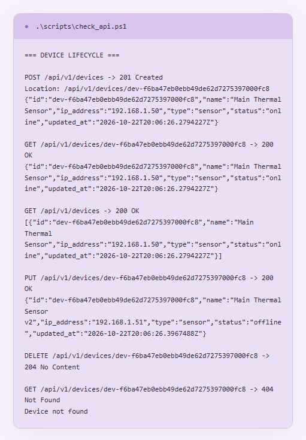
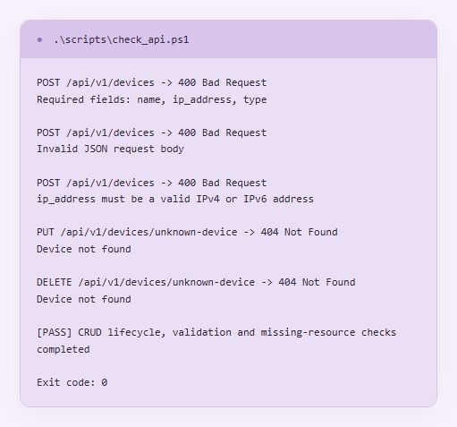
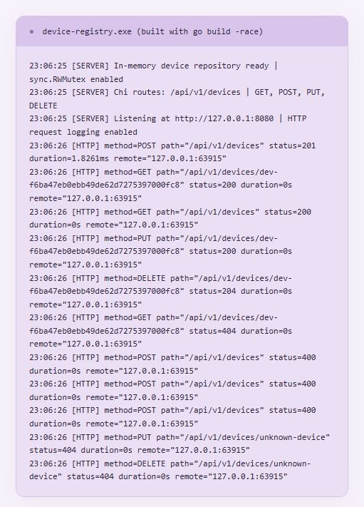
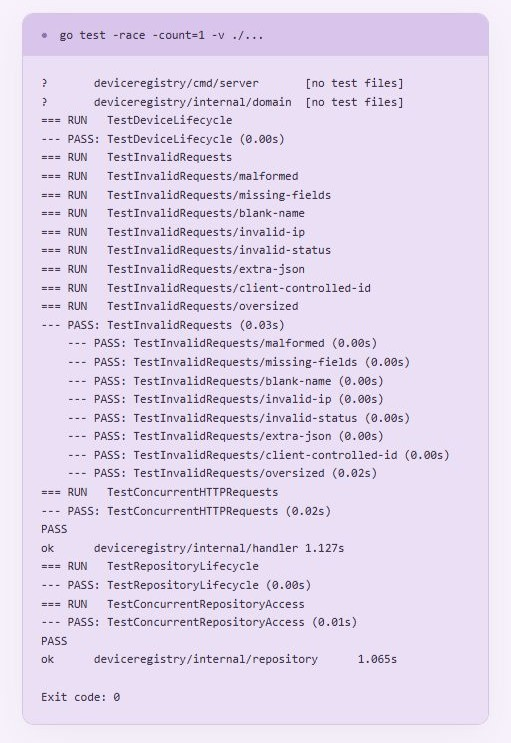

# Практична робота № 4

## Побудова REST API з використанням маршрутизатора Chi

## Мета роботи

Розробити REST API реєстру пристроїв із потокобезпечним сховищем у пам’яті, операціями створення, читання, оновлення й видалення та журналюванням HTTP-запитів

## Реалізована функціональність

- Перший рівень — модель `Device`, інтерфейс репозиторію, сховище з `sync.RWMutex`, створення та читання пристроїв
- Другий рівень — повний CRUD і власний middleware журналювання запитів
- Маршрутизатор Chi, групування через `r.Route` і параметри через `chi.URLParam`
- Унікальні випадкові ID та час модифікації `updated_at` у UTC
- Валідація обов’язкових полів, IPv4/IPv6 та статусів `online` і `offline`
- Обмеження тіла запиту до 1 МіБ та перевірка наявності рівно одного JSON-об’єкта
- Стабільне сортування списку за ID та порожній список у вигляді `[]`
- Заголовок `Location` після створення та порожнє тіло після видалення

Використано [Chi v5.2.3](https://github.com/go-chi/chi/tree/v5.2.3), сумісний із Go 1.22, версію залежності закріплено в `go.mod`, контрольні суми збережено в `go.sum`

## Структура проєкту

| Файл або папка                       | Призначення                                             |
| ------------------------------------ | ------------------------------------------------------- |
| `server/main.go`                     | Запуск HTTP-сервера та налаштування таймаутів           |
| `internal/domain/device.go`          | Структура пристрою з JSON-тегами                        |
| `internal/repository/memory.go`      | Контракт сховища та реалізація на основі map і RWMutex  |
| `internal/repository/memory_test.go` | Перевірки сховища та конкурентного доступу              |
| `internal/handler/devices.go`        | Маршрути Chi, CRUD-обробники, валідація та журналювання |
| `internal/handler/devices_test.go`   | Перевірки HTTP-поведінки та паралельних запитів         |
| `scripts/check_api.ps1`              | Перевірка запущеного сервера через реальні HTTP-запити  |
| `screenshots/`                       | Скріни результатів перевірок                            |
| `evidence/`                          | Текстові журнали фактичних запусків                     |
| `go.mod`, `go.sum`                   | Налаштування модуля та залежності                       |
| `.gitignore`                         | Виключення кешу, тимчасових і виконуваних файлів        |

Папка `internal` обмежує імпорт внутрішніх пакетів іншими Go-проєктами

HTTP-обробники працюють через інтерфейс `DeviceRepository`, читання сховища захищене `RLock`, зміни — `Lock`, копія списку сортується після звільнення блокування

## Запуск

Потрібен Go SDK 1.22 або новіший, для детектора гонок на Windows також потрібен сумісний MinGW-w64 у PATH

У першому терміналі VS Code

```powershell
cd ...\client-server-GO\ChiRouter_REST-API
go mod download
go run -race ./server
```

На цьому комп’ютері Go і MinGW уже налаштовані на диску F

Адреса сервера — `http://127.0.0.1:8080`, після запуску очікується повідомлення `[SERVER] Listening at http://127.0.0.1:8080 | HTTP request logging enabled`

Для запуску на іншому порту

```powershell
go run -race ./server -addr 127.0.0.1:8081
```

Сховище знаходиться в оперативній пам’яті — після перезапуску сервера всі пристрої зникають

## Маршрути API

| Метод  | Шлях                   | Успіх                              | Якщо пристрою немає |
| ------ | ---------------------- | ---------------------------------- | ------------------- |
| GET    | `/api/v1/devices`      | 200 та JSON-масив                  | Порожній масив `[]` |
| POST   | `/api/v1/devices`      | 201, створений пристрій і Location | —                   |
| GET    | `/api/v1/devices/{id}` | 200 та пристрій                    | 404                 |
| PUT    | `/api/v1/devices/{id}` | 200 та оновлений пристрій          | 404                 |
| DELETE | `/api/v1/devices/{id}` | 204 без тіла                       | 404                 |

Для POST і PUT потрібні `name`, `ip_address` та `type`, необов’язковий `status` за замовчуванням отримує значення `offline`

PUT повністю замінює поля пристрою, зберігає ID з URL і встановлює новий `updated_at`, пропущений статус при оновленні також стає `offline`

Поля `id` та `updated_at` формує сервер, передавати їх у POST або PUT не потрібно, невідомі поля відхиляються

Невалідний JSON, пропущені обов’язкові поля, неправильна IP-адреса або статус повертають `400 Bad Request`, помилкові відповіді містять коротке англомовне текстове пояснення

## Перевірка життєвого циклу пристрою

Залишити сервер працювати, у другому терміналі виконати

```powershell
cd ...\client-server-GO\ChiRouter_REST-API
powershell.exe -NoProfile -ExecutionPolicy Bypass -File .\scripts\check_api.ps1
```

Параметр `ExecutionPolicy Bypass` діє лише для цього процесу PowerShell та не змінює постійні налаштування

Сценарій створює пристрій, читає його й загальний список, оновлює, видаляє та перевіряє `404` після видалення, після цього перевіряє валідацію й відсутні ресурси

Сценарій автоматично використовує ID зі створеного об’єкта та прибирає свій пристрій, за успіху завершується повідомленням `[PASS] CRUD lifecycle, validation and missing-resource checks completed`

Якщо сервер запущено на іншому порту

```powershell
powershell.exe -NoProfile -ExecutionPolicy Bypass -File .\scripts\check_api.ps1 -BaseUrl http://127.0.0.1:8081
```



## Окремі запити з термінала

Отримати список і перевірити неіснуючий ID через curl

```powershell
curl.exe -i http://127.0.0.1:8080/api/v1/devices
curl.exe -i http://127.0.0.1:8080/api/v1/devices/unknown-device
```

Пройти CRUD вручну через PowerShell, виконуючи команди послідовно в одному терміналі

```powershell
$base = 'http://127.0.0.1:8080/api/v1/devices'
$body = @{ name = 'Room Sensor'; ip_address = '192.168.1.50'; type = 'sensor'; status = 'online' } | ConvertTo-Json
$device = Invoke-RestMethod -Method Post -Uri $base -ContentType 'application/json' -Body $body
$device
Invoke-RestMethod -Uri "$base/$($device.id)"
$body = @{ name = 'Room Sensor v2'; ip_address = '192.168.1.51'; type = 'sensor'; status = 'offline' } | ConvertTo-Json
Invoke-RestMethod -Method Put -Uri "$base/$($device.id)" -ContentType 'application/json' -Body $body
Invoke-WebRequest -UseBasicParsing -Method Delete -Uri "$base/$($device.id)" | Select-Object StatusCode
curl.exe -i "$base/$($device.id)"
```

Остання команда повинна показати `404 Not Found`, ID підставляється автоматично

## Перевірка валідації

Сценарій перевіряє відсутність обов’язкових полів, зламаний JSON, неправильну IP-адресу, оновлення та видалення неіснуючого пристрою

Коди `400` та `404` у цих сценаріях є очікуваними результатами, а не збоями програми



## Журналювання HTTP-запитів

Middleware обгортає кожен запит і після обробки записує метод, шлях, код відповіді, тривалість та віддалену адресу клієнта



## Автоматичні перевірки

```powershell
go test -race -count=1 -v ./...
go vet ./...
```

Тести використовують окремі сховища й тестові HTTP-сервери на вільних портах, основний сервер для них запускати не потрібно

| Тест                             | Що перевіряє                                                                                            |
| -------------------------------- | ------------------------------------------------------------------------------------------------------- |
| `TestDeviceLifecycle`            | CRUD, Location, JSON, порожній список, повторний PUT, 204 без тіла, 404 після видалення та поля журналу |
| `TestInvalidRequests`            | Валідацію POST і PUT та збереження початкових даних після невдалих запитів                              |
| `TestConcurrentHTTPRequests`     | Створення та читання через 24 одночасні HTTP-клієнти без втрати пристроїв                               |
| `TestRepositoryLifecycle`        | Заборону дублювання ID, незалежність копії списку та поведінку відсутніх ресурсів                       |
| `TestConcurrentRepositoryAccess` | 480 циклів створення, читання, оновлення та видалення з 16 горутин                                      |

Очікуваний результат `PASS` та `ok`, без `FAIL` і `WARNING: DATA RACE`, команда `go vet` за успіху не виводить повідомлень



## Зафіксовані результати

- Створення пристрою — `201 Created`
- Читання списку та пристрою — `200 OK`
- Оновлення — `200 OK`, той самий ID та новий час модифікації
- Видалення — `204 No Content` без тіла
- Читання після видалення — `404 Not Found`
- Невалідні запити — `400 Bad Request`
- Сценарій HTTP-перевірки й тести з `-race` завершилися з кодом `0`
- `go vet`, форматування та збирання сервера завершилися успішно

Для фактичного HTTP-прогону сервер зібрано з прапорцем `-race`, попереджень детектора гонок не виявлено

Скриншоти зроблені зі сторінки перегляду фактичних консольних журналів, окремий вебінтерфейс реєстру до проєкту не додавався

Оригінальні журнали в [requests.txt](evidence/requests.txt), [server.txt](evidence/server.txt), [tests.txt](evidence/tests.txt), [curl.txt](evidence/curl.txt) і [verification.txt](evidence/verification.txt), скріни в папці `creenshots` під назвами `terminal1/2/3`

## Висновок

Реалізовано перший і другий рівні практичної роботи, REST CRUD реєстру пристроїв із розділенням доменної моделі, репозиторію та HTTP-обробників, потокобезпечним доступом до даних і журналюванням запитів

Перевірено повний життєвий цикл пристрою, валідацію даних та конкурентну роботу без виявлених гонок
