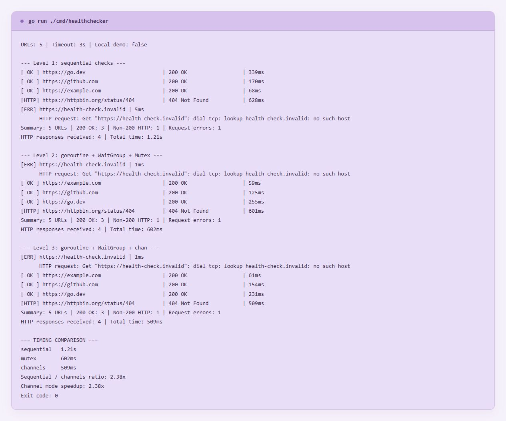
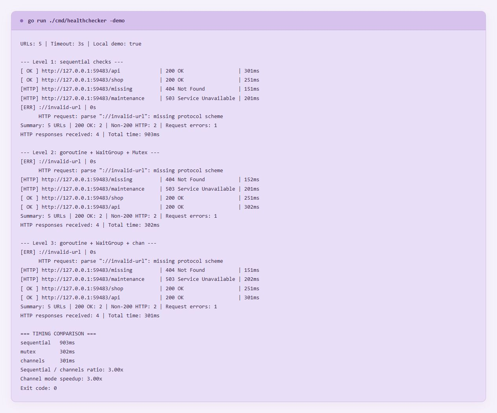
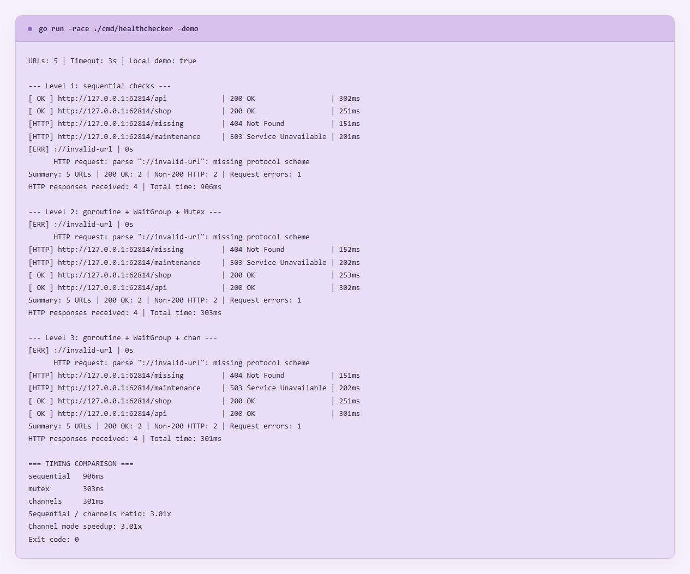
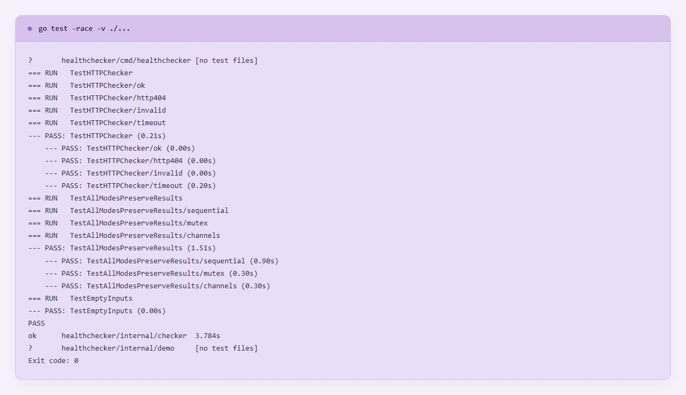

# Практична робота № 1

## Базові конструкції, структури даних та конкурентність у Go

## Мета роботи

Реалізувати консольний моніторинг HTTP-ресурсів, застосувати структури, методи, інтерфейси й явне опрацювання помилок, а також порівняти послідовну та конкурентну обробку запитів

## Реалізована функціональність

- Перевірка п’яти адрес зі збереженням URL, HTTP-статусу, тривалості запиту та помилки
- Три окремі режими виконання зі збереженням функціональності кожного рівня
- Налаштування таймауту та можливість передати власні URL через аргументи командного рядка
- Окремий підрахунок відповідей `200 OK`, інших HTTP-статусів і помилок запиту
- Вимірювання загальної тривалості кожного режиму та розрахунок прискорення
- Локальне демо зі статусами `200`, `404`, `503` та навмисно некоректною адресою
- Автоматичні тести та перевірка детектором гонок

Проєкт використовує лише стандартну бібліотеку Go

## Структура проєкту

| Файл або папка                     | Призначення                                                  |
| ---------------------------------- | ------------------------------------------------------------ |
| `go.mod`                           | Опис Go-модуля `healthchecker`, мінімальна версія Go 1.22    |
| `cmd/healthchecker/main.go`        | Запуск утиліти, аргументи, збір статистики й порівняння часу |
| `cmd/healthchecker/output.go`      | Форматування результатів і назв режимів                      |
| `internal/checker/checker.go`      | HTTP-клієнт, інтерфейс, результат запиту та статистика       |
| `internal/checker/runners.go`      | Послідовний режим, Mutex та канали                           |
| `internal/checker/checker_test.go` | Перевірки HTTP-статусів, некоректного URL і таймауту         |
| `internal/checker/runners_test.go` | Перевірки всіх режимів та порожнього переліку адрес          |
| `internal/demo/server.go`          | Локальний HTTP-сервер для демонстрації                       |
| `screenshots/`                     | Скріни фактичних результатів запусків                        |

Виконувані файли виключені з Git через `.gitignore`

## Запуск

Перевірити реальні сайти в усіх трьох режимах

```powershell
go run ./cmd/healthchecker
```

За замовчуванням перевіряються `https://go.dev`, `https://github.com`, `https://example.com`, `https://httpbin.org/status/404` та навмисно неіснуючий домен `https://health-check.invalid`

Запустити локальну демонстрацію без залежності від зовнішніх сайтів

```powershell
go run ./cmd/healthchecker -demo
```

Окремо запустити кожен рівень

```powershell
go run ./cmd/healthchecker -demo -mode sequential
go run ./cmd/healthchecker -demo -mode mutex
go run ./cmd/healthchecker -demo -mode channels
```

Перевірити власні адреси з таймаутом дві секунди

```powershell
go run ./cmd/healthchecker -mode channels -timeout 2s https://go.dev https://github.com
```

Усі прапорці слід указувати перед URL-адресами

Перевірити конкурентний доступ та запустити тести

```powershell
go run -race ./cmd/healthchecker -demo
go test -race -v ./...
go vet ./...
```

Для запуску потрібен Go SDK 1.22 або новіший, а для `-race` на Windows також сумісний компілятор MinGW-w64 у PATH

Після налаштування PATH слід відкрити новий термінал

## Хід виконання

### Рівень 1 — структури, інтерфейс і послідовні запити

Структура `Result` містить поля `URL string`, `StatusCode int`, `Duration time.Duration` та `Err error`

Інтерфейс `Checker` оголошує метод `Check(url string) Result`, який неявно реалізує структура `HTTPChecker` через метод з одержувачем `*HTTPChecker`

Клієнт `http.Client` має таймаут, тривалість запиту вимірюється через `time.Now()` і `time.Since()`, після отримання відповіді її тіло закривається через `defer response.Body.Close()`

Функція `RunSequential` обходить зріз адрес у звичайному циклі та виконує запити один за одним

### Рівень 2 — горутини, WaitGroup і Mutex

Функція `RunMutex` запускає окрему горутину для кожної адреси, передаючи URL аргументом анонімної функції

Лічильник `WaitGroup` збільшується перед запуском горутини, а `defer wg.Done()` гарантує його зменшення після завершення роботи

Перевірка HTTP виконується поза критичною секцією, а спільний зріз результатів і статистика змінюються лише між `mu.Lock()` та `mu.Unlock()`

Виклик `wg.Wait()` забезпечує завершення всіх перевірок перед поверненням результатів

### Рівень 3 — передавання результатів через канал

Функція `RunChannels` створює небуферизований канал `chan Result`, у який горутини надсилають результати перевірок

Окрема горутина-координатор викликає `wg.Wait()` і закриває канал після завершення всіх відправників

У `main()` цикл `for result := range checker.RunChannels(client, urls)` отримує результати в міру готовності, виводить їх і змінює статистику лише в головній горутині

У цьому режимі Mutex для статистики не потрібен, тому що нею володіє один отримувач

## Результати перевірки

### Реальні мережеві ресурси

У кожному режимі перевірено п’ять адрес — отримано три відповіді `200 OK`, одну `404 Not Found` та одну очікувану DNS-помилку для домену `.invalid`

| Режим             | Загальний час |
| ----------------- | ------------: |
| Послідовний       |       1210 мс |
| Горутини та Mutex |        602 мс |
| Горутини та канал |        509 мс |

Прискорення режиму з каналами відносно послідовного становило **2,38 раза**



### Локальна демонстрація

Локальний сервер моделює затримки 300, 250, 150 та 200 мс, а п’ята адреса навмисно має некоректний формат

У кожному режимі отримано дві відповіді `200 OK`, дві інші HTTP-відповіді та одну помилку запиту

| Режим             | Загальний час |
| ----------------- | ------------: |
| Послідовний       |        903 мс |
| Горутини та Mutex |        302 мс |
| Горутини та канал |        301 мс |

Прискорення становило **3,00 раза** — конкурентний режим очікує переважно найповільніший запит, тоді як послідовний накопичує затримки всіх запитів

Це вимірювання окремого демонстраційного прогону, а не статистичний бенчмарк — результати зовнішніх запитів залежать від мережі, DNS і навантаження серверів, тому канали не обов’язково швидші за Mutex у кожному запуску



### Перевірка відсутності гонок

Команда `go run -race ./cmd/healthchecker -demo` успішно виконала всі три режими з кодом завершення `0`, попереджень `WARNING: DATA RACE` у цьому запуску не виявлено

Навмисні `404`, `503` та некоректний URL демонструють обробку помилкових ситуацій і не є збоями самої програми



### Автоматичні перевірки

- `TestHTTPChecker` — відповіді `200` і `404`, некоректний URL та перевищення таймауту
- `TestAllModesPreserveResults` — однакова статистика в усіх режимах, відсутність загублених або повторних результатів
- `TestEmptyInputs` — коректна робота з порожнім переліком та закриття каналу без зависання
- `go test -race -v ./...` — усі тести пройшли, код завершення `0`
- `go vet ./...` — зауважень не виявлено
- `go build ./cmd/healthchecker` — програму успішно зібрано
- Некоректний режим і нульовий таймаут — зрозуміле повідомлення та код завершення `2`



Скріни зроблені зі сторінки перегляду фактичного збереженого виводу консолі — оригінальні з терміналу доступні у папці `screenshots` під назвами `terminal/1/2/3/4.png`

## Висновок

Реалізовано всі три рівні HTTP-моніторингу з використанням структур, методів, інтерфейсу, явного опрацювання помилок, горутин, WaitGroup, Mutex та каналів

На локальному сценарії конкурентний режим із каналами скоротив загальний час приблизно утричі, а детектор гонок і тести не виявили порушень у перевірених сценаріях
