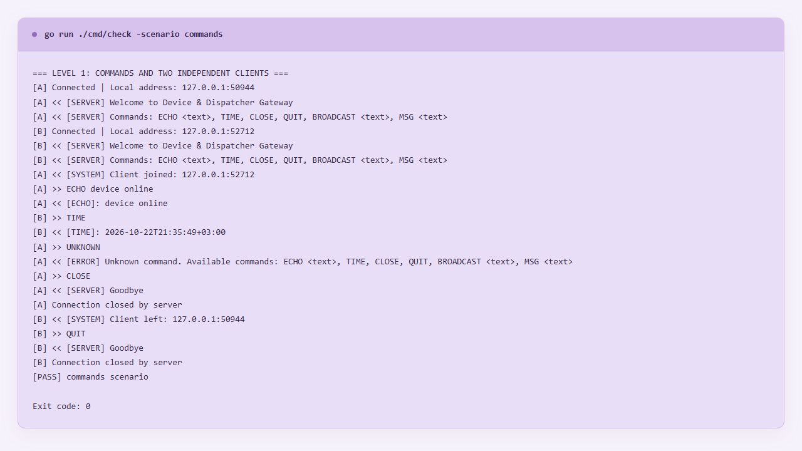
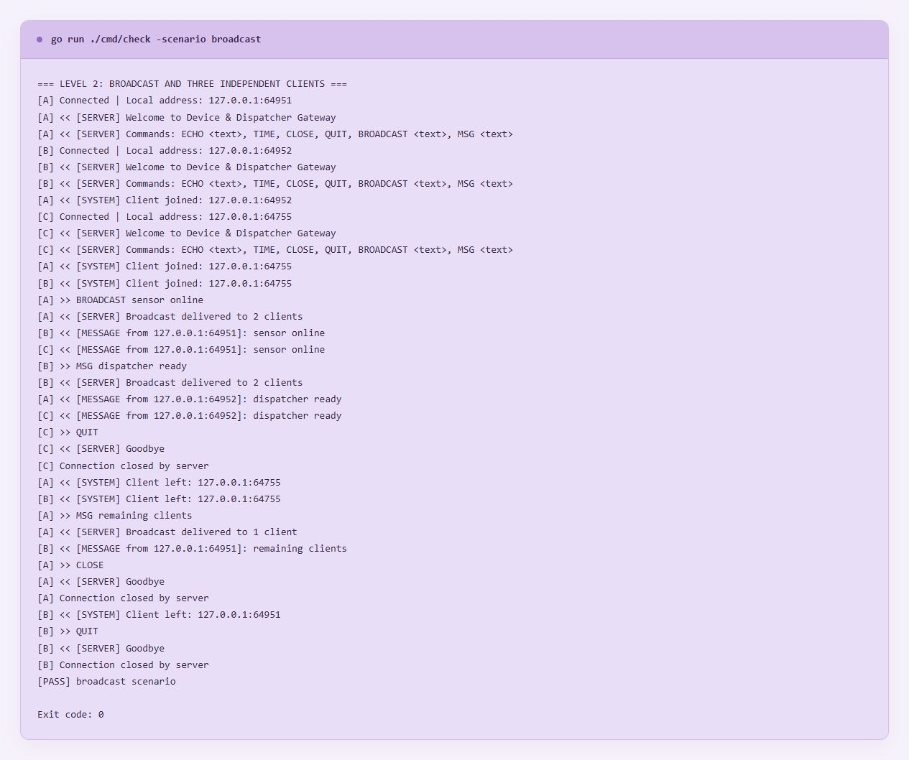
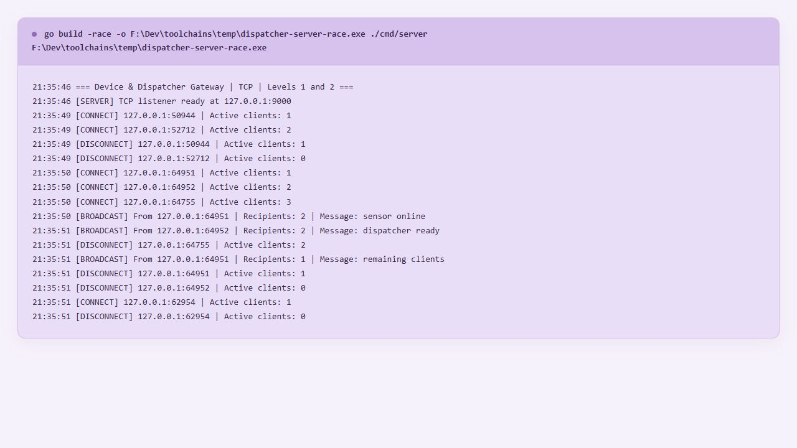
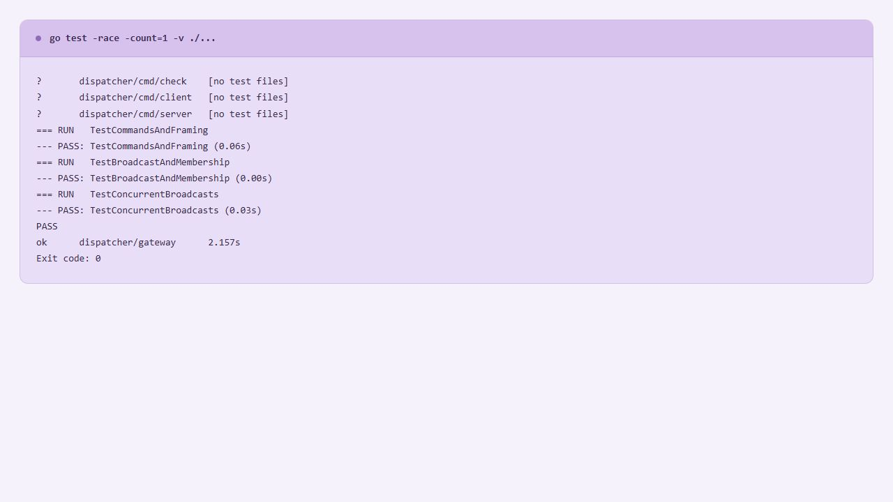

# Практична робота № 2

## Сокетне програмування та обмін повідомленнями по TCP

## Мета роботи

Розробити консольний TCP-сервер засобами стандартного пакета `net`, реалізувати текстовий протокол із розділювачем нового рядка, конкурентне обслуговування клієнтів та потокобезпечну розсилку повідомлень

## Реалізована функціональність

- TCP-слухач із налаштовуваною адресою, за замовчуванням `127.0.0.1:9000`
- Окрема горутина для кожного підключення
- Команди `ECHO`, `TIME`, `CLOSE`, `QUIT`, `BROADCAST` і `MSG`
- Читання команд через `bufio.NewReader` та `ReadString('\n')`
- Очищення рядків через `strings.TrimSpace`, підтримка перенесень LF та CRLF
- Реєстр активних клієнтів під захистом `sync.Mutex`
- Сповіщення іншим клієнтам про приєднання та вихід учасників
- Розсилка повідомлень усім іншим активним клієнтам без повернення самого повідомлення відправнику
- Підтвердження відправнику з кількістю успішних доставлень
- Послідовний запис повідомлень у кожне з’єднання через окремий Mutex
- Таймаут запису для обмеження очікування повільного клієнта
- Власний інтерактивний TCP-клієнт та утиліта автоматичної перевірки
- Тести протоколу, реєстрації, розсилок і конкурентної роботи з детектором гонок

Проєкт використовує лише стандартну бібліотеку Go

## Структура проєкту

| Файл або папка           | Призначення                                                        |
| ------------------------ | ------------------------------------------------------------------ |
| `go.mod`                 | Модуль `dispatcher`, мінімальна версія Go 1.22                     |
| `cmd/server/main.go`     | Аргументи запуску, відкриття TCP-слухача та запуск сервера         |
| `cmd/client/main.go`     | Інтерактивний консольний TCP-клієнт                                |
| `cmd/check/main.go`      | Автоматичні сценарії з двома та трьома незалежними TCP-з’єднаннями |
| `gateway/server.go`      | Приймання клієнтів, реєстр, горутини й розсилка                    |
| `gateway/client.go`      | Захист запису в клієнтське з’єднання та таймаут                    |
| `gateway/protocol.go`    | Розбір команд та формування відповідей                             |
| `gateway/server_test.go` | Автоматичні перевірки протоколу й конкурентності                   |
| `screenshots/`           | Скріни фактичних результатів роботи                                |

Кеш, тимчасові файли й результати збірки виключені через `.gitignore`, інструменти Go та MinGW зберігаються окремо від проєкту на диску F

## Протокол команд

Кожна команда завершується символом нового рядка `\n`, після відповіді з’єднання зберігається до команди виходу або розриву з’єднання

| Команда                          | Результат                                                       |
| -------------------------------- | --------------------------------------------------------------- |
| `ECHO device online`             | `[ECHO]: device online`                                         |
| `TIME`                           | `[TIME]: <час сервера у форматі RFC3339>`                       |
| `BROADCAST sensor online`        | Інші клієнти отримують `[MESSAGE from <адреса>]: sensor online` |
| `MSG dispatcher ready`           | Та сама розсилка через короткий псевдонім                       |
| `CLOSE` або `QUIT`               | `[SERVER] Goodbye` і закриття поточного з’єднання               |
| Невідома команда                 | `[ERROR] Unknown command` зі списком доступних команд           |
| Команда без обов’язкового тексту | `[ERROR] Usage` із правильним форматом                          |

## Запуск

Потрібен Go SDK 1.22 або новіший, для перевірки `-race` на Windows також потрібен сумісний MinGW-w64 у PATH

Після оновлення PATH потрібно відкрити новий термінал або перезапустити VS Code

У кожному терміналі перейти до папки роботи

```powershell
cd ...\client-server-GO\SocketProgramming_TCP
```

У першому терміналі запустити сервер із детектором гонок і залишити його працювати

```powershell
go run -race ./cmd/server
```

Очікуване повідомлення про готовність — `[SERVER] TCP listener ready at 127.0.0.1:9000`

У другому терміналі запустити клієнта A

```powershell
go run ./cmd/client
```

У третьому терміналі так само запустити клієнта B, а в четвертому — клієнта C

```powershell
go run ./cmd/client
```

Команди нижче вводяться в запущений клієнт, а не в PowerShell

## Перевірка команд TCP-сервера

Залишити щонайменше двох клієнтів підключеними одночасно

У клієнті A виконати

```text
ECHO device online
TIME
UNKNOWN
```

Мають з’явитися відповідь з префіксом `[ECHO]:`, поточний час із префіксом `[TIME]:` та зрозуміле повідомлення про невідому команду зі списком доступних команд

У клієнті B виконати `ECHO second client`, щоб перевірити незалежність підключень

## Перевірка широкомовної розсилки

Підключити три клієнти одночасно, залишивши сервер у першому терміналі

У клієнті A виконати

```text
BROADCAST sensor online
```

Клієнти B і C мають отримати повідомлення `[MESSAGE from ...]: sensor online`, а A — підтвердження `[SERVER] Broadcast delivered to 2 clients`

У клієнті B виконати

```text
MSG dispatcher ready
```

Повідомлення мають отримати клієнти A та C

У клієнті C виконати

```text
QUIT
```

Клієнт C має отримати `[SERVER] Goodbye` та завершитися, а клієнти A і B — отримати `[SYSTEM] Client left: ...`

Знову надіслати повідомлення з A

```text
MSG remaining clients
```

Відповідь A має містити `Broadcast delivered to 1 client`, повідомлення має отримати лише B

Завершити клієнта A командою `CLOSE`, клієнта B командою `QUIT`, після завершення перевірок зупинити сервер через `Ctrl+C`

Під час перевірки фіксуються відповіді клієнтів та журнал сервера, попереджень `WARNING: DATA RACE` бути не повинно

## Автоматична перевірка окремо запущеного сервера

Сервер має працювати в іншому терміналі, усі ручні клієнти перед цією перевіркою потрібно закрити — сценарій сам підключає потрібну кількість учасників

Перевірка команд із двома незалежними клієнтами

```powershell
go run ./cmd/check -scenario commands
```

Перевірка розсилки з трьома незалежними клієнтами

```powershell
go run ./cmd/check -scenario broadcast
```

Обидва сценарії послідовно

```powershell
go run ./cmd/check
```

Очікуваний результат — `[PASS] commands scenario` та `[PASS] broadcast scenario`, префікси `[A]`, `[B]` і `[C]` позначають різні TCP-з’єднання, `>>` — надіслану команду, `<<` — отриманий рядок

## Автоматичні тести

Тести самостійно запускають ізольовані сервери на вільних локальних портах, окремо запускати сервер для них не потрібно

```powershell
go test -race -count=1 -v ./...
go vet ./...
```

| Тест                         | Що перевіряє                                                                                                                     |
| ---------------------------- | -------------------------------------------------------------------------------------------------------------------------------- |
| `TestCommandsAndFraming`     | Команди, формат RFC3339, LF і CRLF, помилки, часткову команду без нового рядка, кілька команд в одному записі, `CLOSE` і `QUIT`  |
| `TestBroadcastAndMembership` | Три клієнти, обидві команди розсилки, відсутність повернення повідомлення відправнику, видалення клієнта після розриву з’єднання |
| `TestConcurrentBroadcasts`   | Чотири одночасні клієнти, 20 повідомлень від кожного, доставлення кожного повідомлення іншим трьом клієнтам без дублікатів       |

Успішний результат — `PASS` та `ok`, без `FAIL` і `WARNING: DATA RACE`, рядки `[no test files]` для командних пакетів є нормальними

## Результати виконання

### Команди та одночасна робота двох клієнтів

Окремо запущений TCP-сервер успішно обробив `ECHO`, `TIME`, невідому команду, `CLOSE` і `QUIT`, клієнти отримали сповіщення про приєднання та вихід учасника



### Широкомовна розсилка між трьома клієнтами

Повідомлення від A отримали B та C, повідомлення від B отримали A та C, після виходу C наступне повідомлення отримав лише B — усі перевірки сценарію завершилися успішно



### Журнал TCP-сервера

Сервер зафіксував підключення, розсилки та відключення клієнтів, після завершення сценаріїв кількість активних підключень повернулася до нуля

Для цього прогону сервер зібрано командою `go build -race`, попереджень про гонки в перевірених сценаріях не виявлено



### Перевірка конкурентності

Тести з `-race` завершилися успішно, `go vet` не виявив зауважень, сервер та інтерактивний клієнт успішно зібрані

Під час конкурентного тесту виконано 80 команд розсилки та перевірено 240 отриманих повідомлень іншими клієнтами, а також 80 підтверджень відправникам



Навмисна невідома команда та неправильний формат команд демонструють обробку помилкових запитів, вони не означають збій сервера

Команда збірки сервера з детектором гонок і підсумки перевірки зафіксовані у [verification.txt](evidence/verification.txt)

## Інша адреса або зайнятий порт

Якщо порт `9000` зайнятий, використати інший вільний порт та вказати ту саму адресу серверу й клієнту

```powershell
go run -race ./cmd/server -addr 127.0.0.1:9010
```

В іншому терміналі

```powershell
go run ./cmd/client -addr 127.0.0.1:9010
```

Для перевірки на цій адресі

```powershell
go run ./cmd/check -addr 127.0.0.1:9010
```

## Висновок

Виконано рівні 1 та 2 — створено багатоклієнтський TCP-сервер команд, текстовий протокол із розділювачем нового рядка, захищений реєстр підключень і широкомовну розсилку

Перевірено роботу двох та трьох незалежних TCP-клієнтів, коректне видалення відключених учасників і конкурентні розсилки без виявлених гонок у проведених перевірках
