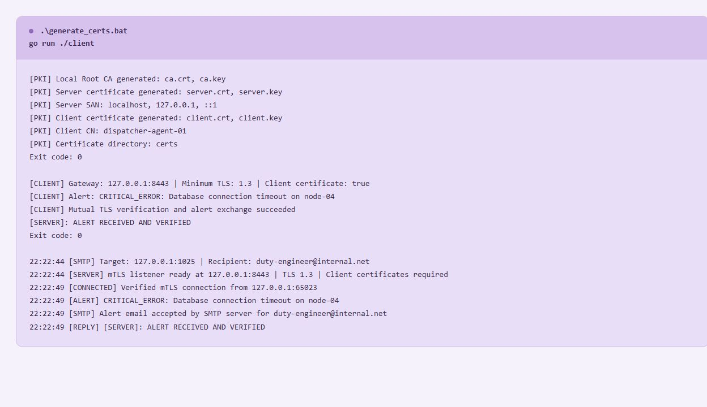
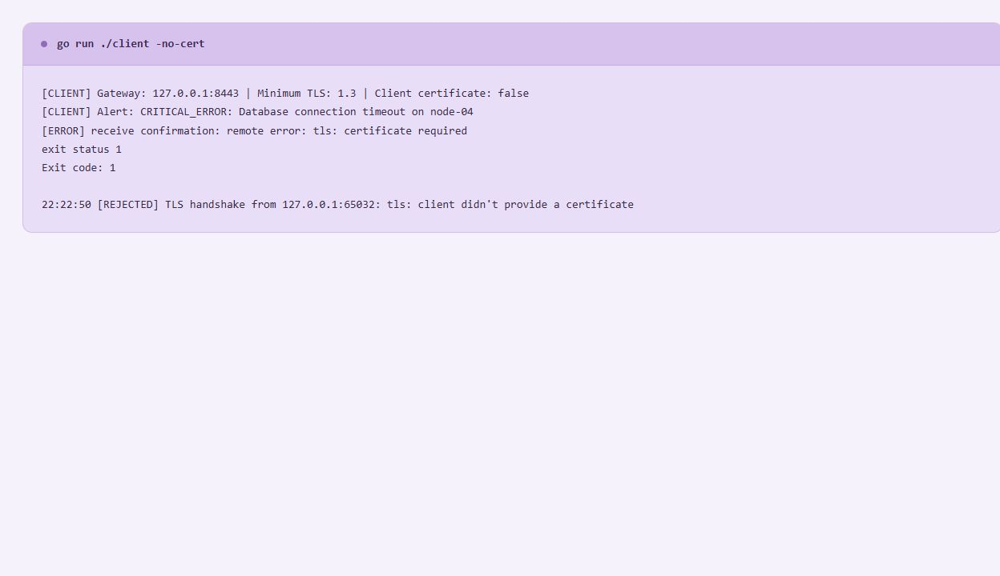
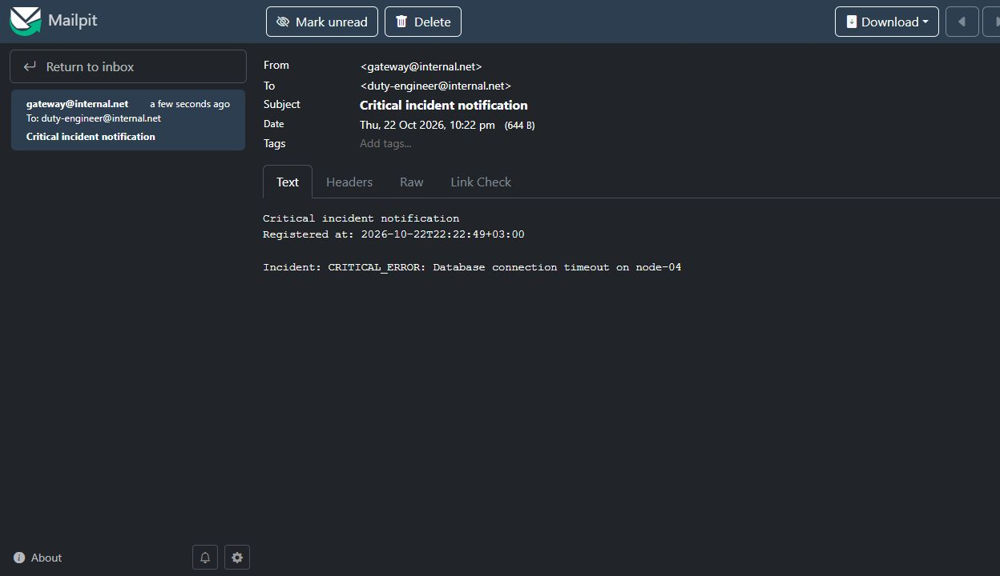
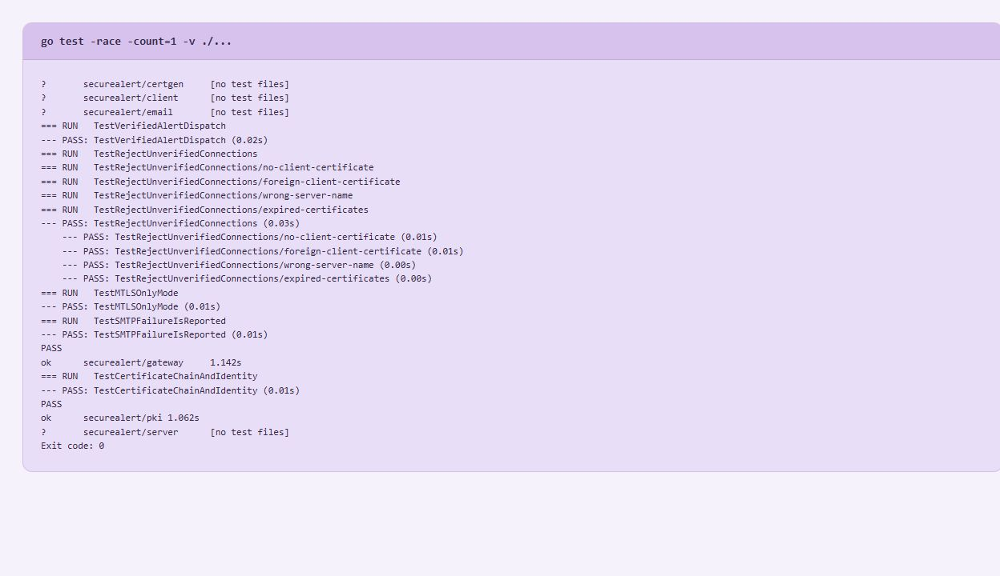

# Практична робота № 3

## Налаштування захищеного каналу mTLS та протокол SMTP

## Мета роботи

Створити локальну інфраструктуру сертифікатів X.509, захищений TCP-шлюз з обов’язковою перевіркою сертифікатів клієнтів та автоматичне надсилання повідомлень про інциденти через SMTP

## Реалізована функціональність

- Генерація Root CA, серверного та клієнтського сертифікатів через стандартну криптографію Go
- Серверний SAN для `localhost`, `127.0.0.1` та `::1`
- Клієнтський сертифікат із `CN=dispatcher-agent-01`
- TLS 1.3 та політика `tls.RequireAndVerifyClientCert`
- Перевірка серверного сертифіката клієнтом через спільний Root CA
- Приймання однорядкового інциденту та підтвердження `[SERVER]: ALERT RECEIVED AND VERIFIED`
- Автоматичне надсилання текстового email на `duty-engineer@internal.net`
- Заголовки `From`, `To`, `Subject` і `Date`, текст інциденту та час реєстрації у тілі листа
- Локальне отримання та перегляд листів у Mailpit
- Відхилення неавторизованих клієнтів без надсилання email
- Повідомлення про помилку SMTP замість неправдивого підтвердження доставлення

Проєкт використовує лише стандартну бібліотеку Go, залежностей у `go.mod` немає

## Структура проєкту

| Файл або папка             | Призначення                                                      |
| -------------------------- | ---------------------------------------------------------------- |
| `server/main.go`           | Запуск mTLS-слухача та налаштування SMTP                         |
| `client/main.go`           | Надсилання інциденту та спроба підключення без сертифіката       |
| `certgen/main.go`          | Команда генерації сертифікатів                                   |
| `pki/generate.go`          | Створення ключів ECDSA P-256 та сертифікатів X.509               |
| `pki/tls.go`               | Завантаження Root CA та конфігурацій TLS                         |
| `pki/certificates_test.go` | Перевірка ланцюжка довіри, SAN та клієнтського CN                |
| `gateway/server.go`        | Обробка TLS-рукостискання, інциденту й виклику поштового сервісу |
| `gateway/client.go`        | Захищене підключення та отримання підтвердження                  |
| `gateway/server_test.go`   | Перевірки авторизації, сповіщень і помилок SMTP                  |
| `email/service.go`         | Параметризоване надсилання листів через `net/smtp`               |
| `generate_certs.bat`       | Windows-сценарій запуску генератора                              |
| `certs/`                   | Локальні сертифікати та ключі                                    |
| `screenshots/`             | Результати запусків і лист у Mailpit                             |
| `evidence/`                | Оригінальні текстові журнали перевірок                           |

Кеш, виконувані файли, бази Mailpit та згенеровані сертифікати й ключі виключені через `.gitignore`

Після клонування репозиторію сертифікати та ключі потрібно згенерувати командою `.\generate_certs.bat`

## Генерація PKI

Потрібен Go SDK 1.22 або новіший, OpenSSL для цього сценарію не потрібен

У терміналі PowerShell перейти до папки роботи

```powershell
cd F:\Dev\client-server-GO\mTLS-secure_SMTP
```

Створити сертифікати

```powershell
.\generate_certs.bat
```

У папці `certs/` утворюються шість файлів — `ca.crt`, `ca.key`, `server.crt`, `server.key`, `client.crt` та `client.key`

Сертифікати мають строк дії один рік, серверний сертифікат призначений для `ServerAuth`, клієнтський — для `ClientAuth`, обидва підписані створеним Root CA

Якщо повний набір уже створений, цей крок можна пропустити — генератор не перезаписує наявні файли без явного прапорця

Для заміни всього локального набору

```powershell
.\generate_certs.bat -force
```

Після заміни сертифікатів потрібно перезапустити шлюз

## Запуск SMTP-емулятора

У першому терміналі запустити

```powershell
& "F:\Dev\toolchains\mailpit\mailpit.exe" --listen 127.0.0.1:8025 --smtp 127.0.0.1:1025 --database "F:\Dev\toolchains\mailpit\secure-alert-lab.db" --disable-version-check
```

Залишити Mailpit працювати та відкрити [вебінтерфейс](http://127.0.0.1:8025)

На іншому комп’ютері Mailpit можна отримати з [офіційної сторінки встановлення](https://mailpit.axllent.org/docs/install/) та вказати власний шлях до виконуваного файлу

У стандартному локальному режимі Mailpit приймає SMTP без авторизації та шифрування — це варіант А з ТЗ, доступний лише на вказаній loopback-адресі, див [налаштування SMTP Mailpit](https://mailpit.axllent.org/docs/configuration/smtp/)

Поштовий сервіс виконує STARTTLS із перевіркою сертифіката, якщо SMTP-сервер оголошує цю можливість, а канал між агентом і шлюзом в усіх режимах використовує mTLS

## Запуск mTLS-шлюзу

У другому терміналі перейти до папки проєкту й запустити

```powershell
cd F:\Dev\client-server-GO\mTLS-secure_SMTP
go run -race ./server
```

Для `-race` на Windows потрібен сумісний MinGW-w64 у PATH, на цьому комп’ютері Go і MinGW уже налаштовані на диску F

Очікуване повідомлення готовності — `[SERVER] mTLS listener ready at 127.0.0.1:8443 | TLS 1.3 | Client certificates required`

Сервер завантажує `server.crt`, `server.key` та `ca.crt`, відкриває сокет через `tls.Listen` і явно виконує `Handshake()` перед читанням повідомлення

## Перевірка авторизованого клієнта

У третьому терміналі виконати

```powershell
cd F:\Dev\client-server-GO\mTLS-secure_SMTP
go run ./client
```

За замовчуванням надсилається інцидент

```text
CRITICAL_ERROR: Database connection timeout on node-04
```

Клієнт підключається через `tls.DialWithDialer`, який додає таймаут до TLS-підключення, та перевіряє сертифікат сервера через локальний Root CA

Очікувана відповідь після успішного приймання інциденту та передавання листа SMTP-серверу

```text
[SERVER]: ALERT RECEIVED AND VERIFIED
```

Надсилання іншого повідомлення

```powershell
go run ./client -message "CRITICAL_ERROR: Sensor link lost on node-07"
```



## Перевірка відхилення доступу

При запущеному шлюзі виконати

```powershell
go run ./client -no-cert
```

Клієнт довіряє серверному CA, але не надає власного сертифіката — очікується помилка `tls: certificate required` та ненульовий код завершення

Сервер має зафіксувати `[REJECTED] TLS handshake ... client didn't provide a certificate`, новий email після цієї спроби не повинен з’явитися

Ця відмова є очікуваним результатом перевірки захисту



## Перевірка email-сповіщення

У Mailpit відкрити лист `Critical incident notification` та перевірити

- Відправник — `gateway@internal.net`
- Отримувач — `duty-engineer@internal.net`
- Наявність поля `Registered at` із часом у форматі RFC3339
- Наявність повного тексту інциденту

Під час контрольного прогону після авторизованого підключення та спроби без сертифіката в Mailpit залишився рівно один лист

Надходження листа підтверджене через API Mailpit та його вебінтерфейс, у журналі шлюзу зафіксоване успішне приймання листа локальним SMTP-сервером



## Перевірка рівня 1 окремо від SMTP

Зупинити поточний шлюз через `Ctrl+C` і запустити його без надсилання email

```powershell
go run -race ./server -email=false
```

В іншому терміналі виконати `go run ./client` — захищене підключення та підтвердження працюватимуть без запущеного Mailpit

Для повернення до другого рівня зупинити цей процес та запустити `go run -race ./server`

## Автоматичні перевірки

Тести створюють власні тимчасові PKI та сервери на вільних портах, запуск Mailpit або основного шлюзу для них не потрібен

```powershell
go test -race -count=1 -v ./...
go vet ./...
```

| Тест                              | Що перевіряє                                                                                                                          |
| --------------------------------- | ------------------------------------------------------------------------------------------------------------------------------------- |
| `TestCertificateChainAndIdentity` | Підписи спільного CA, серверні SAN, призначення сертифікатів та клієнтський CN                                                        |
| `TestVerifiedAlertDispatch`       | Приймання алерту, підтвердження, отримувача листа, текст інциденту та час реєстрації                                                  |
| `TestRejectUnverifiedConnections` | Відхилення підключень без клієнтського сертифіката, з чужим сертифікатом, неправильним ім’ям сервера та простроченим ланцюжком довіри |
| `TestMTLSOnlyMode`                | Збереження роботи першого рівня без SMTP                                                                                              |
| `TestSMTPFailureIsReported`       | Передавання клієнту помилки при невдалому надсиланні email                                                                            |

Очікуваний результат — `PASS` та `ok`, без `FAIL` і `WARNING: DATA RACE`, рядки `[no test files]` для пакетів без окремих тестів є нормальними



## Зафіксовані результати

- Згенеровано потрібні шість файлів PKI
- Авторизований клієнт передав інцидент та отримав точне підтвердження з ТЗ
- Клієнт без сертифіката відхилений на рівні TLS
- Email успішно отриманий у Mailpit та містить потрібні заголовки, інцидент і час реєстрації
- Відхилений клієнт не спричинив надсилання додаткового email
- Тести з `-race`, аналізатор Go та `go vet` завершилися успішно

Зображення команд і тестів зроблені зі сторінки перегляду фактичних журналів, скриншот листа зроблений безпосередньо в Mailpit

Оригінальні результати доступні у [pki.txt](evidence/pki.txt), [authorized.txt](evidence/authorized.txt), [rejected.txt](evidence/rejected.txt), [server.txt](evidence/server.txt), [email.txt](evidence/email.txt), [tests.txt](evidence/tests.txt) і [verification.txt](evidence/verification.txt)

## Висновок

Створено локальний ланцюжок довіри, налаштовано взаємну TLS-автентифікацію та автоматичне SMTP-сповіщення про перевірений інцидент

Контрольний прогін підтвердив доставлення листа авторизованого клієнта й відхилення підключення без сертифіката, усі проведені автоматичні перевірки завершилися успішно
